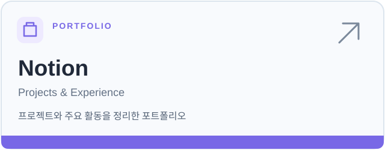

<h3>
Interested in AI, LLMs, Computer Vision, and Database Systems. 
I enjoy learning new technologies and applying them to solve real-world problems.
</h3>

---

## `01. ABOUT`

<table>
  <tr>
    <td><b>🏫 University</b></td>
    <td>Dong-Eui University</td>
  </tr>
  <tr>
    <td><b>🎓 Major</b></td>
    <td>Department of Applied Software Engineering</td>
  </tr>
  <tr>
    <td><b>💡 Interests</b></td>
    <td>AI · LLM · Computer Vision · Database</td>
  </tr>
  <tr>
    <td><b>🚀 Focus</b></td>
    <td>AI &amp; Data-Driven Problem Solving</td>
  </tr>
</table>

 

---
## `02. PROJECTS`

<table>
  <tr>
    <td width="100%">

<h2>AI-Based Flood Detection & Road Safety System</h2>

카메라 영상, 수위 센서 및 기상 데이터를 활용하여 터널·지하차도의 침수 위험을 감지하고, 
위험 상황에 대응하기 위한 AI 기반 도로 안전 관리 시스템

<h4>Tech Stack</h4>

<h4>My Contributions</h4>

<ul>
  <li>기상청 API 연동 및 강수량 데이터 수집 기능 구현</li>
  <li>AI 학습 데이터셋 조사 및 시연용 하드웨어 구성 검토</li>
</ul>

 

  </tr>
</table>

 

<table>
  <tr>
    <td width="100%" align="center">

<h3>Computer Vision Project</h3>

A new computer vision project is on the way.

 
  </tr>
</table>

 

## `03. CERTIFICATIONS`

  
  &nbsp;&nbsp;
  

 

---

## `04. TECH STACK`

<h3>Languages & Database</h3>

<table>
<tr>
<th>Technology</th>
<th>Proficiency</th>
<th>Experience</th>
</tr>

<tr>
<td><b>C++</b></td>
<td>★★★★★</td>
<td>STL, 자료구조, 알고리즘 문제 해결 및 객체지향 프로그래밍</td>
</tr>

<tr>
<td><b>Python</b></td>
<td>★★★☆☆</td>
<td>API 호출 및 데이터 처리 학습</td>
</tr>

<tr>
<td><b>SQL / MySQL</b></td>
<td>★★★☆☆</td>
<td>JOIN, GROUP BY, 서브쿼리 및 데이터 조회</td>
</tr>
</table>

 

---

## `05. LINKS`

  
  &nbsp;&nbsp;
  

 

---

## `06. AWARDS & ACTIVITIES`

<h3>Achievements & Awards</h3>

- 🏆 **교내 코딩 사이트 전체 1위**
  - C++ 중심 알고리즘 문제 해결 · 약 2년간 1위 유지
  - [View Ranking](http://ascode.org/ranklist.php)

- 🏅 **C++ 튜터링 우수상**
  - 2025년 1학기 · 튜터 활동
  - [View Award](./tutoring-award-2025-1.pdf)

<h3>Training & Tutoring</h3>

- 🎓 **교내 부트캠프 고급 과정 수료** (2026년 여름방학)
  - [View Certificate](./bootcamp-advanced.pdf)

- 🎓 **교내 부트캠프 중급 과정 수료** (2026년 여름방학)
  - [View Certificate](./bootcamp-intermediate.pdf)

- 📘 **C++ 튜터링 프로그램 — 튜터** (2025년 1학기)
  - [View Certificate](./tutoring-2025-1.pdf)

- 📘 **C++ 튜터링 프로그램 — 튜티** (2024년 2학기)
  - [View Certificate](./tutoring-2024-2.pdf)

- 📘 **C++ 튜터링 프로그램 — 튜티** (2024년 1학기)
  - [View Certificate](./tutoring-2024-1.pdf)

<h3>Other Experience</h3>

- 🔍 **데이터 라벨링 검수 경험**
  - 이미지 데이터 라벨링 결과 검토 및 수정

- 🥉 **교내 코딩 대회 장려상**
  - 2024년 2학기

 

---
