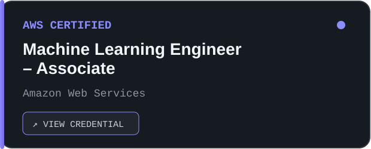
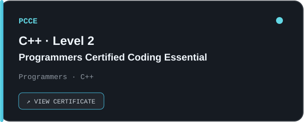
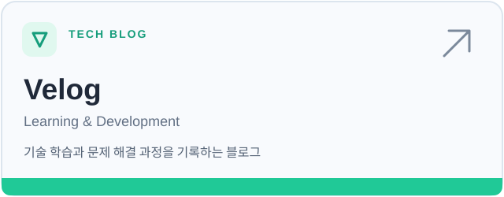

<h3>
Interested in AI, LLMs, Computer Vision, and Database Systems. 
I enjoy learning new technologies and applying them to solve real-world problems.
</h3>

---

## `01. ABOUT`

<table>
  <tr>
    <td><b>🏫 University</b></td>
    <td>Dong-Eui University</td>
  </tr>
  <tr>
    <td><b>🎓 Major</b></td>
    <td>Department of Applied Software Engineering</td>
  </tr>
  <tr>
    <td><b>💡 Interests</b></td>
    <td>AI · LLM · Computer Vision · Database</td>
  </tr>
  <tr>
    <td><b>🚀 Focus</b></td>
    <td>AI &amp; Data-Driven Problem Solving</td>
  </tr>
</table>

 

---

## `02. PROJECTS`

<table>
  <tr>
    <td width="100%">

<h2>AI-Based Flood Detection & Road Safety System</h2>

카메라 영상, 수위 센서 및 기상 데이터를 활용하여 터널·지하차도의 침수 위험을 감지하고, 위험 상황에 대응하기 위한 AI 기반 도로 안전 관리 시스템

<h4>Tech Stack</h4>

<h4>My Contributions</h4>

<b>Completed</b>
<ul>
<li>기상청 API 신청 및 호출 테스트</li>
<li>AI 학습 데이터셋 공동 조사</li>
<li>시연용 하드웨어 구성 검토 및 구매 목록 정리</li>
</ul>

<b>Planned</b>
<ul>
<li>기상청 데이터 수집 및 위험도 데이터 결합 모듈 개발</li>
<li>AI 학습 데이터 라벨링 및 Ollama 기반 LLM 자동 보고서 구현</li>
<li>실제 센서·카메라 데이터 기반 시스템 통합 테스트 및 오류 수정</li>
</ul>

<h4>🏆 Competitions</h4>

<table>
  <tr>
    <th>Competition</th>
    <th>Status</th>
  </tr>
  <tr>
    <td>2026 모두의 창업 2차</td>
    <td>1R 진출 · 참가 중</td>
  </tr>
  <tr>
    <td>교내 콜라보 경진대회</td>
    <td>예선 참가 중</td>
  </tr>
  <tr>
    <td>교내 캡스톤 경진대회</td>
    <td>예선 참가 중</td>
  </tr>
</table>

  </tr>
</table>

 

<table>
  <tr>
    <td width="100%" align="center">

<h3>Computer Vision Project</h3>

A new computer vision project is on the way.

 
  </tr>
</table>

 
---

## `03. CERTIFICATIONS`

  
  &nbsp;&nbsp;
  

 

---

## `04. TECH STACK`

<h3>Languages & Database</h3>

<table>
<tr>
<th>Technology</th>
<th>Proficiency</th>
<th>Experience</th>
</tr>

<tr>
<td><b>C++</b></td>
<td>★★★★★</td>
<td>STL, 자료구조, 알고리즘 문제 해결 및 객체지향 프로그래밍</td>
</tr>

<tr>
<td><b>Python</b></td>
<td>★★★☆☆</td>
<td>API 호출 및 데이터 처리 학습</td>
</tr>

<tr>
<td><b>SQL / MySQL</b></td>
<td>★★★☆☆</td>
<td>JOIN, GROUP BY, 서브쿼리 및 데이터 조회</td>
</tr>
</table>

 

---

## `05. LINKS`

  
  &nbsp;&nbsp;
  

 

---
